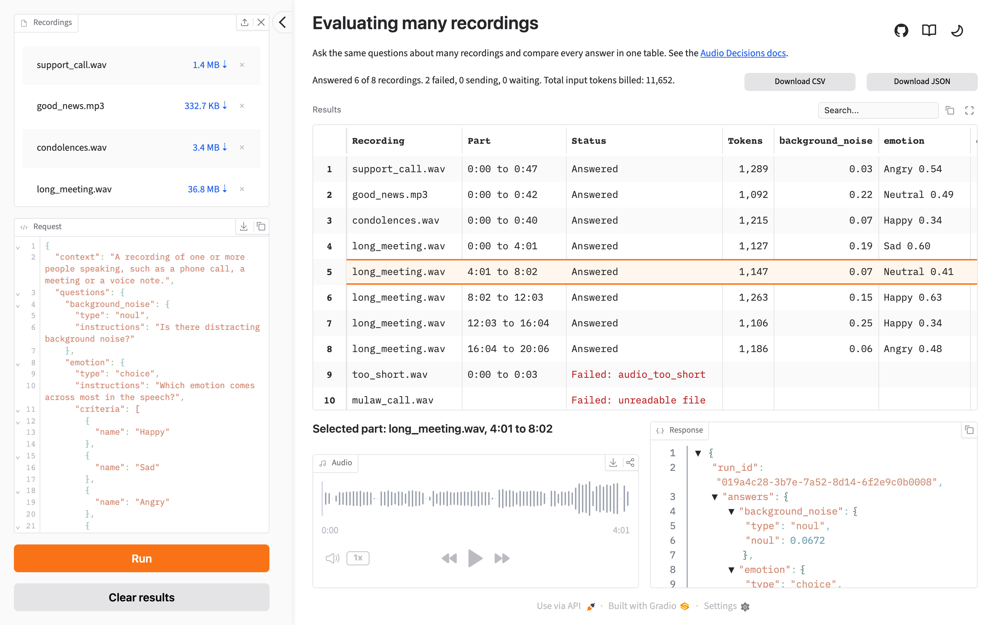

# Evaluating many recordings

A Gradio example that asks the same questions about many recordings with the [Audio Decisions API](https://dev.hume.ai/audio-decisions/docs/overview) and compares every answer in one table. The [cookbook guide](https://dev.hume.ai/audio-decisions/cookbooks/evaluating-many-recordings) walks through the code.

<picture>
  <source media="(prefers-color-scheme: dark)" srcset="docs/screenshot-dark.png">
  
</picture>

## Prerequisites

1. Python 3.11 or later. [uv](https://docs.astral.sh/uv/) installs the version in `.python-version` for you.
2. An API key from the [API keys page](https://cloud.hume.ai/settings/organization/api-keys) of the Hume Platform.

## Getting started

1. Clone the repository:

   ```bash
   git clone https://github.com/HumeAI/hume-audio-decisions-gradio-uploader-example.git
   cd hume-audio-decisions-gradio-uploader-example
   ```

2. Install the dependencies with uv:

   ```bash
   uv sync
   ```

   Or with pip:

   ```bash
   python3 -m venv .venv
   source .venv/bin/activate
   pip install -r requirements.txt
   ```

3. Set your API key:

   ```bash
   export HUME_API_KEY=your_api_key
   ```

4. Start the app with `uv run app.py`, or `python app.py` in the activated environment, and open [http://localhost:7860](http://localhost:7860).

## Using the app

1. Add MP3 or WAV recordings to **Recordings** in the sidebar.
2. Edit the **Request**. It is the `request` part of an API call as JSON, with an optional `context` and up to 100 `questions`, so a request from the docs pastes in unchanged. The default asks four questions, one of each type. See [Writing questions](https://dev.hume.ai/audio-decisions/docs/writing-questions).
3. Press **Run**. A recording of up to 5 minutes is sent as one part, and a longer one is cut into the fewest equal parts of up to 5 minutes. Each part gets its own row with the input tokens its request was billed, and the line above the table counts the recordings and gives the total tokens billed.
4. When a run ends, the first row is selected, unless you selected one during the run. Select a row to hear its part and see its full response. The player plays only the part, exactly the audio that was sent, so its times and the response's moment times count from the start of the part, while the table's count from the start of the recording. A WAV part is sent mixed down to one channel at no more than 16 kHz, which is what the model hears, so it can sound duller than the recording.
5. While a run is going, **Stop** takes the place of **Run**. Press it to cancel the requests in flight, which aren't billed. Press **Run** again to send only what has no answer yet. A part that failed for a reason that can pass, such as a timeout, is sent again; a part whose file the API rejected is not.
6. Download the table as CSV, or every response and error as JSON, once a run ends or stops. To ask different questions about recordings that already have answers, press **Clear results** first.

All questions in a request are answered together, so adding, removing or rewording one question can change the answers to the others.

## Limits

1. Recordings must be MP3, or WAV with PCM or floating-point samples. A WAV file in another encoding, such as μ-law, fails as an unreadable file, and its response shows an ffmpeg command that converts it.
2. Each file can be up to 1 GB. The app holds a whole recording in memory while it sends it or cuts out the selected part, and sends four recordings at a time.
3. The app sends at most 50 requests a minute. Each organization can send 60 requests a minute across all of its API keys, so this leaves room for other work.
4. Results last as long as the browser tab. Reloading the page starts over, so download the results first.
5. The app has no sign-in, so anyone who can reach it can spend your API key. It listens only on your own machine; don't share or expose it.

See [Limits](https://dev.hume.ai/audio-decisions/docs/limits) for the API's own limits.

## How it works

1. `questions.py` holds `DEFAULT_REQUEST` and `parse_request`, which turns the editor's text into a `DecisionsRequest` or raises `ValueError` with the message the editor shows. Before anything is sent, Run checks the recordings and the request with these messages.
2. `evaluation.py` sends the recordings. `make_client` builds an `AsyncDecisionsClient` on an `httpx.AsyncClient` whose request hook paces every request, retries included. `evaluate` sends each recording through the SDK's `iter_create_chunked`, four recordings at a time, and yields each part's result as it arrives. `cut` cuts a part out again with the same settings, for the player. An error that every recording would hit, such as a rejected API key, stops the whole batch, and Stop cancels the requests in flight.
3. `results.py` builds the session's results from that progress: the rows and cells of the table with the stretch to cut for each part, the status line, the stretch of each recording still to send, and the two downloads.
4. `app.py` lays out the page and joins the three. It creates the SDK client at startup, which reads `HUME_API_KEY` there, so the key never reaches the browser and a missing key stops the app before it starts. Every event is private, so Gradio's client libraries can't call the app's endpoints. The header's links and theme button are the HTML, CSS and JavaScript in `assets/`, and `assets/app.css` keeps the recordings list four files tall and gives the request editor the rest of the sidebar's height.

## Adapt it

1. The default request is `DEFAULT_REQUEST` in `questions.py`.
2. The pacing rate is `REQUESTS_PER_MINUTE` in `evaluation.py`, the number of recordings sent at once is `CONCURRENT_RECORDINGS`, and the longest part is `MAX_PART_MS`. More recordings at a time hold more audio in memory.
3. Each answer's cell is formatted by `_cell` in `results.py`.

## Development

1. `uv run ruff format --check` checks formatting, and `uv run ruff format` applies it.
2. `uv run ruff check` lints.
3. `uv run mypy .` type checks.
4. `uv run pytest` runs the tests, which need no API key or network.

## License

[MIT](LICENSE)
